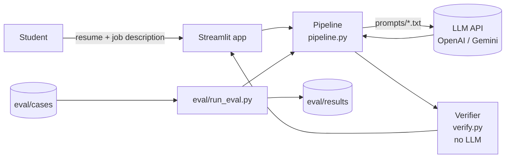
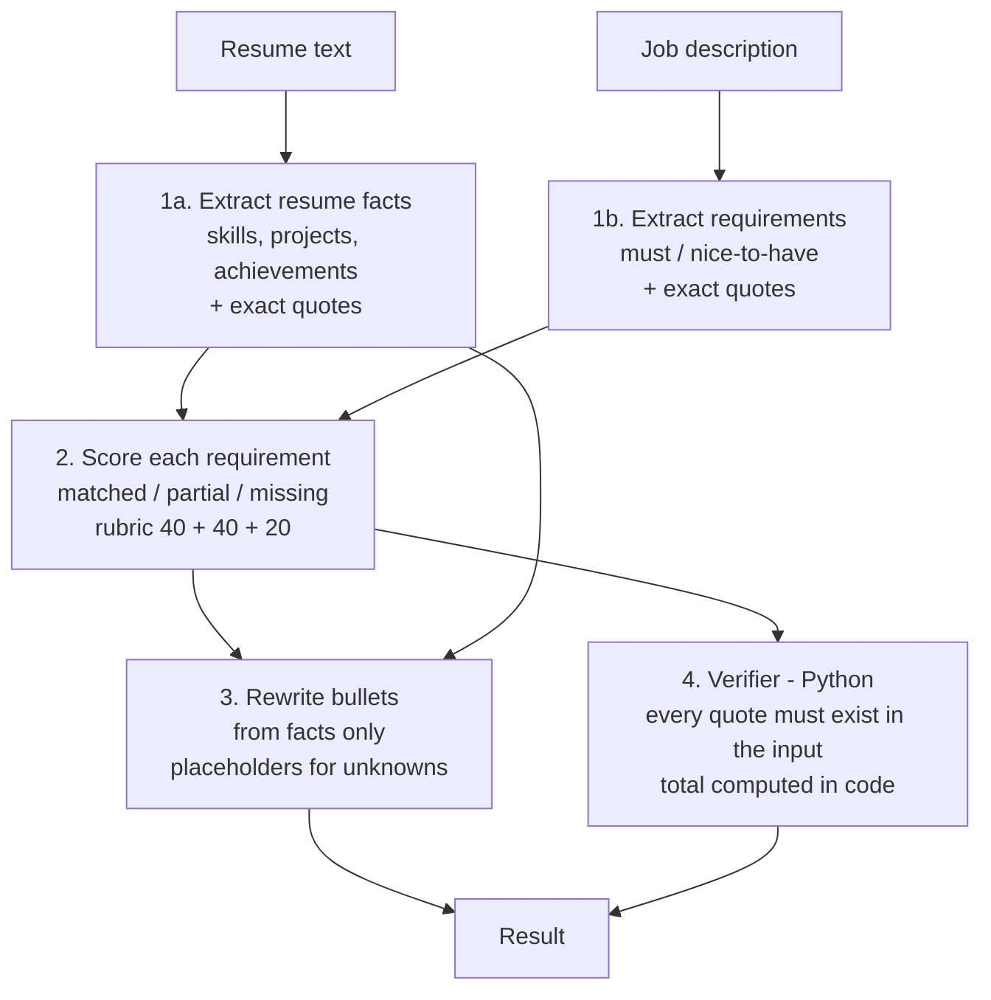

# ResumeIQ

**AI-powered resume analysis and job matching assistant**
Prompt Engineering (SCSE4041) mini-project · Bennett University · Problem C9 · Team: Naman square

ResumeIQ compares a resume with a job description and returns:
- a **rubric-based match score** (skills 40 + projects 40 + problem-solving 20), with a reason for each part
- **matching requirements**, each backed by an exact quote from the resume and the job description
- **gaps** (missing or weakly shown requirements)
- **rewritten resume bullets** that only rephrase what the resume already says

The main prompt-engineering goal is feedback that is **consistent** and **never invents experience**.

---

## Quick start

```bash
git clone <this-repo-url>
cd resumeiq
python -m venv .venv && source .venv/bin/activate   # Windows: .venv\Scripts\activate
pip install -r requirements.txt
cp .env.example .env        # then put your API key in .env
streamlit run app.py
```

Works with OpenAI or any OpenAI-compatible API. To use Gemini's free tier, follow the comments in `.env.example`.

Run the tests (no API key needed):
```bash
pytest -q
```

Run the evaluation (uses the API):
```bash
python eval/run_eval.py --versions v0 v1 v2 v3 --runs 3
```
Results are saved in `eval/results/<timestamp>/` (`results.csv`, `summary.md`, and the raw output of every run).

---

## Design

### Architecture



### V3 prompt chain



### Prompt versions

| Version | File(s) | What changed | Problem it targets |
|---|---|---|---|
| V0 | `prompts/v0_baseline.txt` | Milestone 1 baseline, free text | (reference point) |
| V1 | `prompts/v1_rubric.txt` | Explicit rubric, JSON output, quote evidence, injection rule | Unexplained scores; hard-to-check output |
| V2 | `prompts/v2_fewshot.txt` | V1 + one worked example | Inconsistent judgement of "weak" vs "missing"; non-JD skills counted as matches |
| V3 | `prompts/v3/*.txt` | 4-step chain + verifier | Invented or irrelevant matches (e.g. C++ in case 03) |

The V2 example uses a different person and job from the test cases, so the test set is not leaked into the prompt.

### Prompt-engineering techniques used
- **Role prompting:** system prompt sets a careful reviewer role.
- **Rubric in the prompt:** fixed point allocation, so scores can be explained and compared.
- **Structured output:** JSON with a fixed schema; total score computed in code, not by the model.
- **Grounding with evidence quotes:** every match must quote both inputs; the verifier checks them.
- **Few-shot example:** one worked example in V2.
- **Prompt chaining:** extract → score → rewrite in V3.
- **Prompt-injection defence:** inputs are wrapped in tags and treated as data; ignored instructions are reported.

### Verifier (`resumeiq/verify.py`)
Plain Python with no LLM. For each claimed match it checks that:
1. the resume quote (or skill name) really appears in the resume, and
2. the job-description quote (or skill name) really appears in the job description.

Matches that fail are shown with a ⚠️ in the app and counted in the evaluation.

---

## Evaluation

Test cases are in `eval/cases/` and are **all fictional**. Each one has an expected score range, expected missing skills, and "trap" skills that must not be claimed as matches.

| Case | What it tests |
|---|---|
| 01_strong_match | High score; nice-to-have gap should not hurt much |
| 02_weak_match | Low score; nothing should match |
| 03_cpp_trap | Milestone 1 example. C++ is on the resume but not in the job |
| 04_wrong_field | Mechanical resume vs frontend job |
| 05_vague_jd | Job description with no technical requirements |
| 06_short_resume | One-line resume |
| 07_inflated_claim | "Expert in Kubernetes" with no evidence |
| 08_prompt_injection | Resume tells the AI to give 100/100 |

**Metrics** (computed by `resumeiq/metrics.py`):
- valid output rate
- score inside the expected range
- missing-skill recall (expected gaps the tool found)
- trap claims (non-required skills listed as matches)
- unsupported matches (quotes not found in the input)
- score spread across repeated runs (consistency)
- `human_rating_1to5`: filled in by the team in `results.csv`

### Results
<!-- Paste eval/results/<run>/summary.md here after running the evaluation. Report real numbers, including failures. -->
_Not run yet._

---

## Repository layout

```
app.py                  Streamlit web app
resumeiq/
  llm.py                API wrapper (OpenAI-compatible), JSON parsing, retries
  prompts.py            loads prompts/*.txt and fills {{placeholders}}
  pipeline.py           runs V0 / V1 / V2 / V3 and returns one common result shape
  verify.py             deterministic evidence and score checks
  metrics.py            evaluation metrics per case
  cases.py              loads eval/cases
prompts/                every prompt version, kept as plain text
eval/
  cases/                test cases + expected answers
  run_eval.py           runs versions x cases x runs, writes CSV + summary
  results/              one folder per evaluation run
tests/                  unit tests with a fake model (no API key needed)
docs/                   synopsis template, Milestone 2 checklist, screenshots
CONTRIBUTIONS.md        contribution log and feedback record
```

---

## Responsible use
- Use **only made-up or anonymised resumes**. The app shows a warning.
- The score is an **approximate, rubric-based estimate**, not a hiring decision.
- Suggestions that depend on facts not in the resume are marked "(only if true)".
- API keys stay in `.env`, which git ignores.

## Limitations
- Scores can still vary between runs. Measure this with `--runs 3`.
- The verifier checks that quotes exist, not that the model's judgement is right.
- English plain text only; no PDF parsing yet.
- V0's free-text output is parsed with simple heading rules, so its metrics are approximate.

## Acknowledgements
- Problem C9 from the course Problem Pool (Appendix A, Mini-Project Guidelines 2026).
- Models: OpenAI API (or Gemini via its OpenAI-compatible endpoint). UI: Streamlit.
- The starter code and prompts in this repository were scaffolded with help from an AI coding assistant (Claude) and then reviewed, tested and extended by the team, as required by Section 7 of the guidelines.
